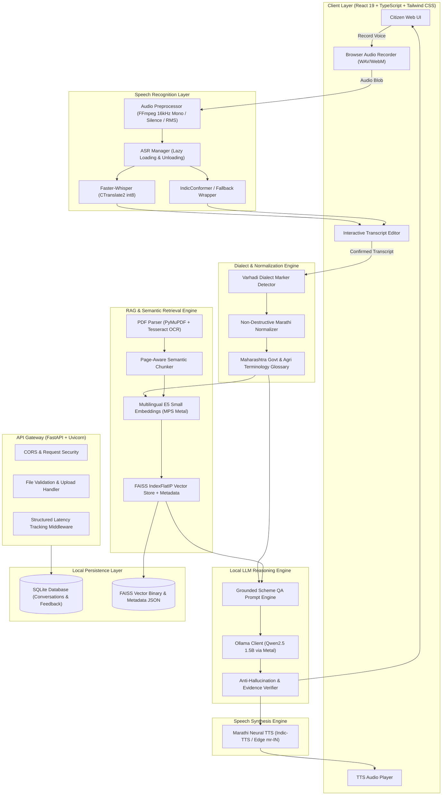

# BharatLangTech AI – Architecture Specification

## 1. Executive Summary

**BharatLangTech AI** is an open-source, dialect-aware multilingual voice intelligence platform tailored for Marathi and regional dialect (Varhadi / Vidarbha) speakers inquiring about Maharashtra state and central government schemes.

The platform is designed to execute completely offline on consumer Apple Silicon hardware (MacBook Air M2, 16GB unified memory) without reliance on cloud APIs (no OpenAI, Gemini, or Claude).

---

## 2. High-Level System Architecture

---

## 3. Component Details

### 3.1 Speech-to-Text Pipeline (`backend/app/services/asr/`)
* **Audio Preprocessing (`backend/app/utils/audio.py`):**
  - Raw PCM stream extraction via `ffmpeg` CLI: converts any browser audio format (WAV, MP3, WebM, OGG, AAC) into a 16kHz mono float32 numpy array.
  - Computes RMS energy, peak normalization, and silence detection. Rejects empty recordings with clear diagnostic warnings.
* **ASR Engines:**
  - `FasterWhisperEngine`: Uses CTranslate2 int8 quantization with Devanagari prompt conditioning (`नमस्कार, मला शेतकरी कर्जमाफी...`). Extracts calibrated word/segment timestamps and genuine log-probability confidence scores.
  - `IndicConformerEngine`: AI4Bharat IndicConformer wrapper with environment detection and verified fallback to Whisper-small when NeMo is constrained.
  - `ASRManager`: Dynamic model registry supporting runtime engine switching, lazy model loading, and explicit model unloading to conserve Apple Silicon RAM.

### 3.2 Dialect & Language Normalization (`backend/app/services/translation/normalization.py`)
* **Non-Destructive Principle:**
  - The citizen's original spoken transcript is permanently preserved for audit and evaluation.
  - A standardized Marathi representation is computed separately to optimize semantic vector retrieval.
* **Varhadi Dialect Markers:**
  - Identifies phonetic and morphological patterns specific to Vidarbha Varhadi (e.g., `व्हाया` -> `होणे`, `व्हते` -> `होते`, `पायजे` -> `पाहिजे`, `कायले` -> `कशाला`, `तुम्ही` -> `तुम्ही`, `इचारतो` -> `विचारतो`).
* **Government Scheme Glossary:**
  - Standardizes agricultural and administrative terminology (e.g., `कर्जमाफी` -> Mahatma Jyotirao Phule Shetkari Karjmukti Yojana, `पीक विमा` -> Pradhan Mantri Fasal Bima Yojana, `८-अ / ७/१२` -> land records).

### 3.3 Semantic Retrieval & Document Ingestion (`backend/app/services/rag/`)
* **Document Parser (`backend/app/utils/pdf.py`):**
  - PyMuPDF reads embedded text layers directly.
  - If a page has < 50 characters (e.g. scanned government resolutions), Tesseract OCR is triggered with Marathi (`mar`) and Hindi (`hin`) trained models.
* **Page-Aware Chunker (`backend/app/services/rag/chunking.py`):**
  - Splits text by paragraphs and double newlines while respecting sentence boundaries.
  - Attaches `doc_id`, `title`, and original `page` numbers to every chunk so citations remain verifiable.
* **Vector Indexing (`backend/app/services/rag/retrieval.py`):**
  - Embeddings generated using `intfloat/multilingual-e5-small` (384 dimensions) on Apple Silicon `mps` device.
  - FAISS `IndexFlatIP` calculates inner products on normalized vectors (equivalent to cosine similarity).
  - Atomic persistence to `backend/data/indexes/faiss_index.bin` and `chunks_metadata.json`.

### 3.4 Local LLM Reasoning (`backend/app/services/llm/`)
* **Offline Model:** Qwen2.5 1.5B running via Ollama locally on Apple Silicon Metal acceleration.
* **Evidence Grounding Prompt:**
  - Strictly instructs the model to only use facts present in the retrieved context chunks.
  - Enforces mandatory 7-part output structure:
    1. **योजनेचे नाव** (Scheme Name)
    2. **थोडक्यात माहिती** (Simple Explanation)
    3. **पात्रता निकष** (Eligibility Criteria)
    4. **आवश्यक कागदपत्रे** (Required Documents)
    5. **अर्ज प्रक्रिया** (Application Procedure)
    6. **महत्वाच्या अटी** (Important Conditions / Deadlines)
    7. **संदर्भ** (Document Name & Page Number)
  - Prohibits hallucination: If the document does not mention an eligibility condition or deadline, it explicitly reports "माहिती उपलब्ध नाही" (Information not available).

### 3.5 Speech Synthesis (`backend/app/services/tts/`)
* Neural Marathi speech synthesis producing crisp Devanagari audio.
* Supported voices: `mr-IN-AarohiNeural` (Female) and `mr-IN-ManoharNeural` (Male).
* Audio files cached in `backend/data/audio_cache/` and served over HTTP.

---

## 4. Hardware Optimization for Apple Silicon M2 (16 GB)

| Component | Precision / Runtime | Hardware Device | Memory Footprint |
| :--- | :--- | :--- | :--- |
| **FastAPI Backend** | Python 3.11+ / Uvicorn | CPU (ARM64) | ~90 MB |
| **Faster-Whisper ASR** | int8 / CTranslate2 | CPU (NEON 4 cores) | ~480 MB |
| **Multilingual E5 Small** | float32 / PyTorch | Apple Silicon MPS | ~320 MB |
| **FAISS Index** | IndexFlatIP | CPU RAM | ~15 MB |
| **Ollama (Qwen2.5 1.5B)** | Q4_K_M GGUF | Apple Silicon Metal GPU | ~986 MB |
| **React Frontend** | Node.js / Vite / Browser | Webkit / Chromium | ~120 MB |
| **Total Resident Memory** | — | — | **~2.01 GB / 16 GB (12.5%)** |

The system leaves over 13 GB of unified memory completely free for OS and multi-tasking workflows.

